# Sid · Delhi to Newcastle

The personal portfolio of **Siddhant Bhasin** (Sid), a software engineer working on AI/ML, LLM systems and data pipelines.

It isn't a CV with a scroll bar. It tells the story of the move from Delhi to Newcastle as one long metro ride: a first C++ program on a school PC, a line map of every job, a day one in Newcastle, a train that stops at each of my best projects, and a Students' Union noticeboard full of side projects.

**Live: [siddhantbhasin.me](https://siddhantbhasin.me)**

<p align="center">
  <a href="docs/site-tour.mp4">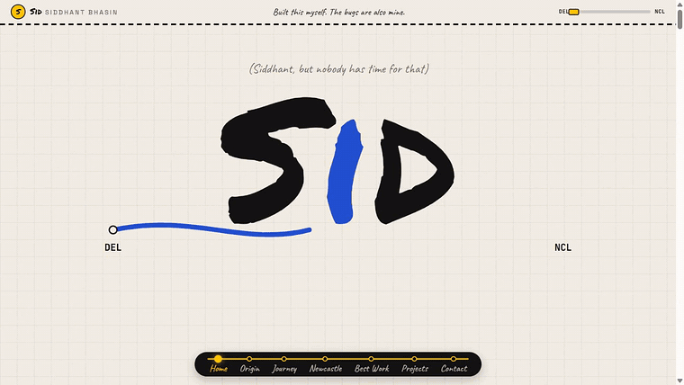</a>
</p>
<p align="center"><a href="docs/site-tour.mp4">Watch the full 50 second tour (MP4)</a></p>

---

## Contents

- [A tour of the site](#a-tour-of-the-site)
- [Tech stack](#tech-stack)
- [Architecture](#architecture)
- [How the scroll engine works](#how-the-scroll-engine-works)
- [Project structure](#project-structure)
- [Editing the content](#editing-the-content)
- [Running it locally](#running-it-locally)
- [Deploying](#deploying)
- [Accessibility and performance](#accessibility-and-performance)
- [Easter eggs](#easter-eggs)

---

## A tour of the site

| # | Section | What happens |
|---|---|---|
| 00 | **Hero** | A hand-drawn "SID" with a line drawn from DEL to NCL: the Blue Line, a flight, then the Yellow Line. |
| 01 | **Origin** | An exercise-book page. A beige CRT boots up, a first C++ program types itself out, compiles, then runs (and prints `my world.my control.` because 16 year old me forgot the `endl`). The teacher marks it in red pen. |
| 02 | **The journey** | A horizontal metro line map: school lab, Pune, Noida, Delhi, a one way boarding pass DEL to NCL, then Gateshead and Haymarket. The paper warms from Delhi tan to Newcastle grey as you ride. |
| 03 | **Newcastle** | A poster board for day one: a Five Swans receipt, a Tyne Bridge postcard, polaroids of the Millennium Bridge, Grey's Monument and the Angel of the North, a Metro ticket and the weather. |
| 04 | **Best work** | A working platform. A train pulls in, the doors open, and the project is inside the carriage window. Scroll and the train leaves; the next one arrives at the next station. Stats get slapped on like stickers. |
| 05 | **Side projects** | A Students' Union noticeboard. Every project is its own flyer and the tear-off tabs are the links. |
| 06 | **Contact** | Next stop: you. |

### Screenshots

| | |
|---|---|
| 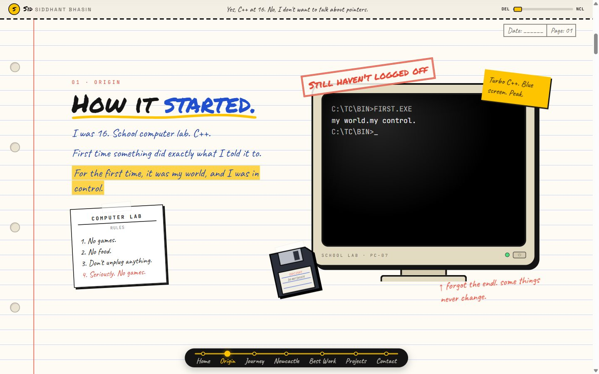 | 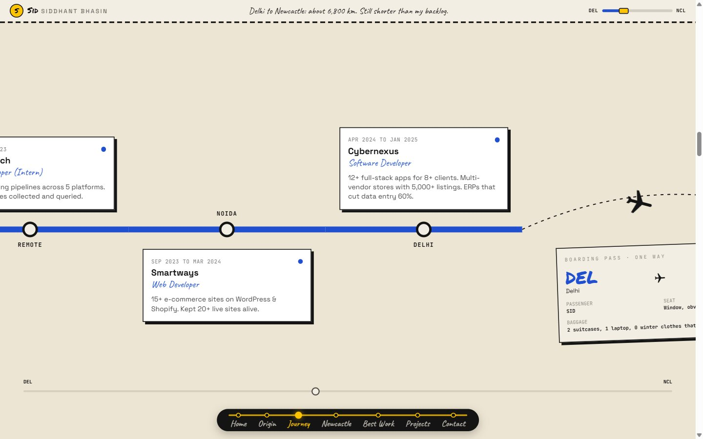 |
| **Origin:** the exercise book and PC-07 | **Journey:** the line map from Delhi |
| 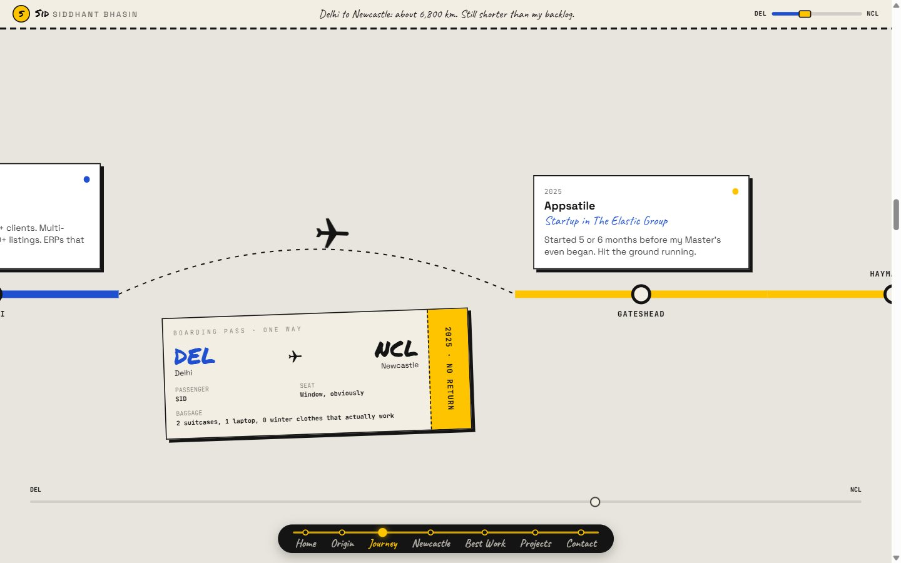 | 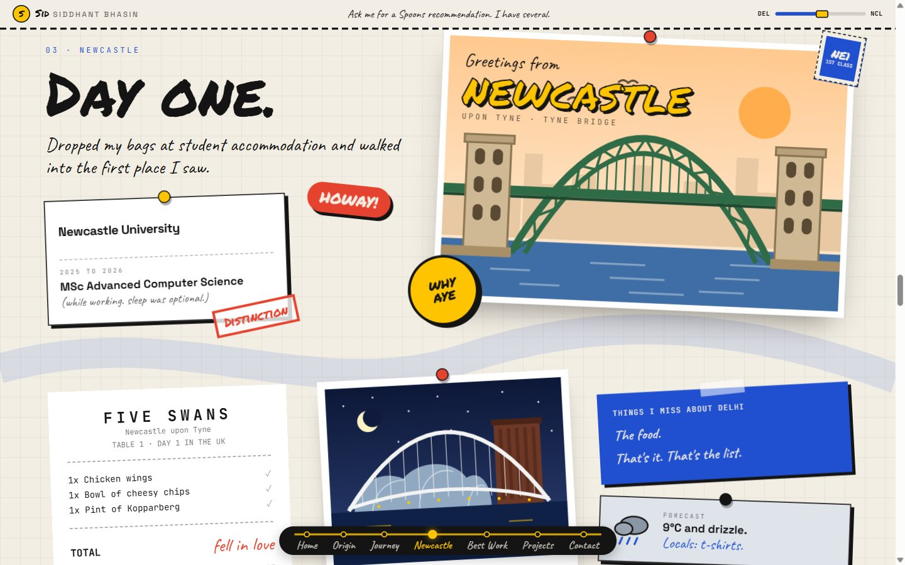 |
| **Journey:** DEL to NCL, one way | **Newcastle:** day one |
| 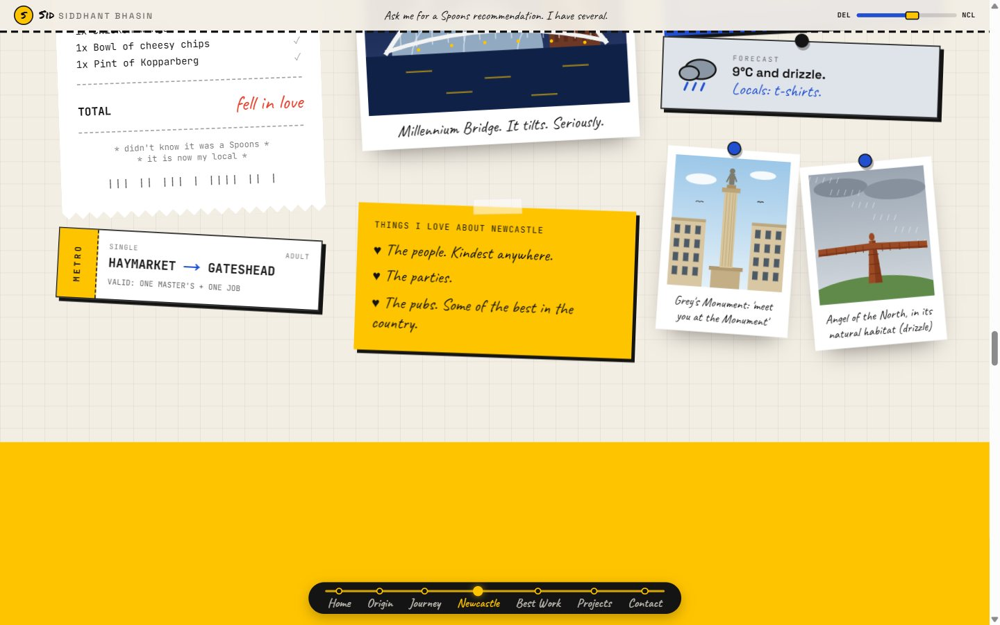 | 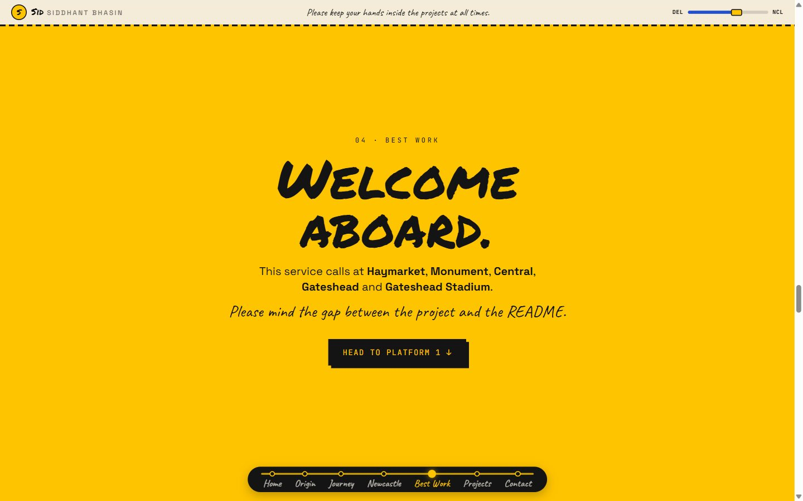 |
| **Newcastle:** the poster board | **Best work:** welcome aboard |
| 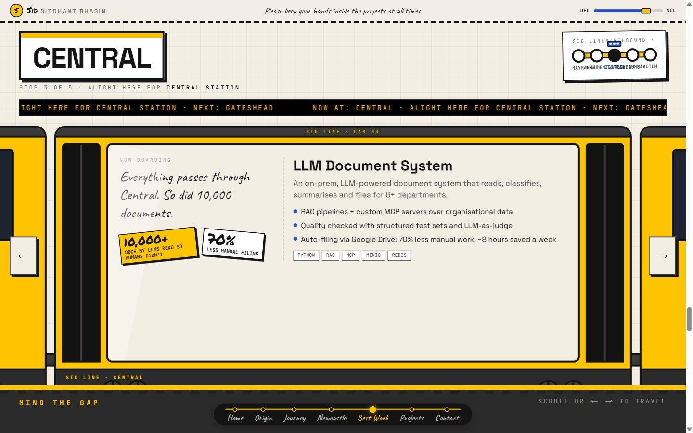 | 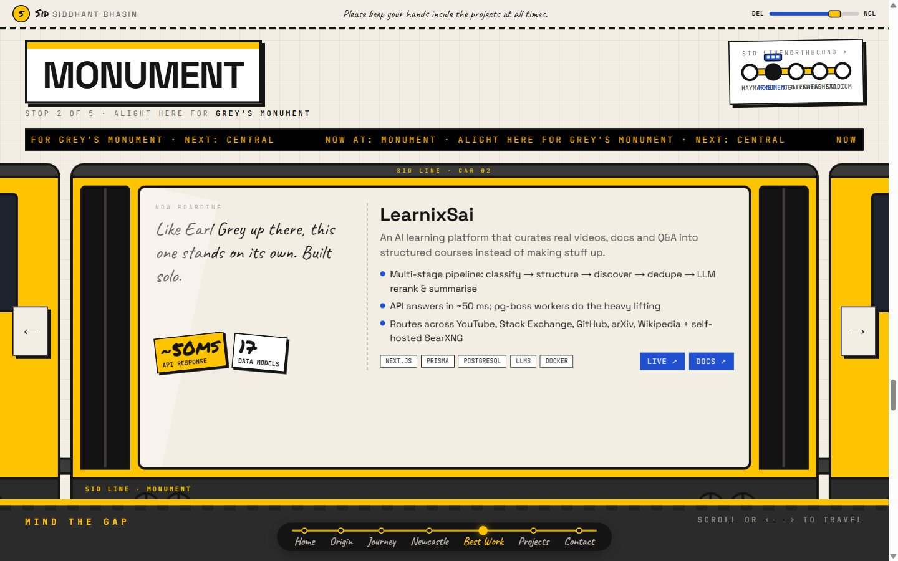 |
| **Best work:** Central, the LLM document system | **Best work:** Monument, LearnixSai |
| 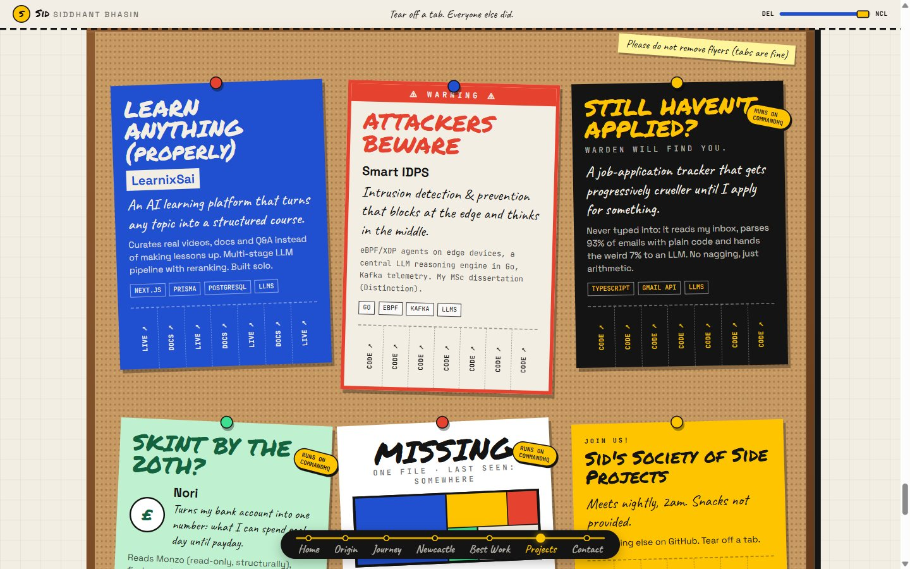 | 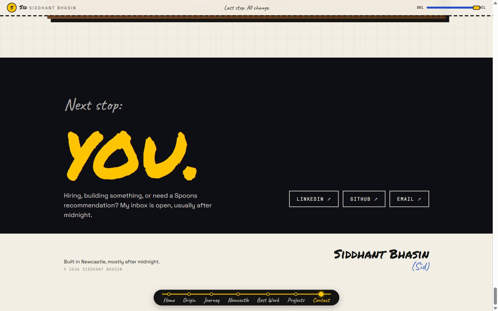 |
| **Side projects:** the Union noticeboard | **Contact** |

On a phone:

<p>
  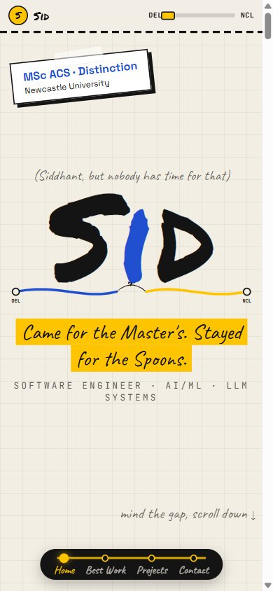
  &nbsp;
  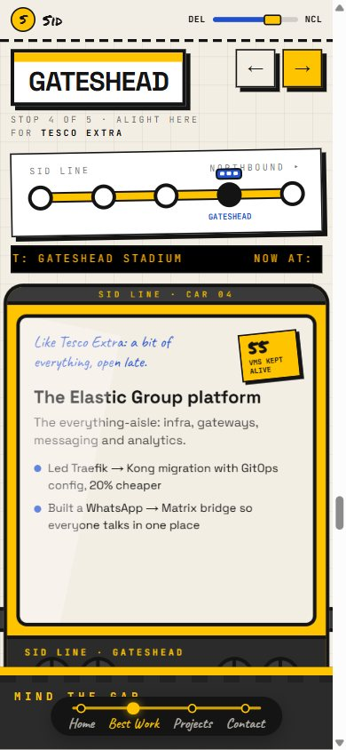
</p>

---

## Tech stack

| Layer | Choice | Why |
|---|---|---|
| Framework | **Next.js 15** (App Router), **React 19**, **TypeScript** | Static prerendered page, fast first load, easy Vercel deploys. |
| Styling | **Tailwind CSS v4** | Design tokens live in `globals.css` (`@theme`), everything else is utility classes. |
| Animation | **GSAP 3** with **ScrollTrigger** and `@gsap/react` (`useGSAP`) | Pinning, scrubbing and timelines, with automatic cleanup per component. |
| Smooth scroll | **Lenis** | Smooth wheel scrolling, kept in sync with ScrollTrigger on the GSAP ticker. |
| Fonts | `next/font/google`: Permanent Marker, Caveat, Space Grotesk, JetBrains Mono | Self hosted at build time, no layout shift. |
| Art | Hand-built inline SVG and CSS | Every landmark, the train, the CRT and the floppy disk are code. No image assets needed. |

The whole page is prerendered as static HTML (`○ /` in the build output). There is no backend.

---

## Architecture

```
app/page.tsx
│
├── <SmoothScroll/>   Lenis instance, drives ScrollTrigger from the GSAP ticker
├── <Loader/>         "Next train: Sid" departure board, holds scroll until it lifts
│
├── <main>
│   ├── <Hero/>        intro timeline + parallax
│   ├── <Origin/>      pinned · 3 stepped scenes (boot+type, compile, run)
│   ├── <Journey/>     pinned · horizontal scrub along the line map
│   ├── <Arrival/>     poster board · batched reveals + parallax layers
│   ├── <BestWork/>    pinned · one scrubbed timeline for the whole train ride
│   ├── <Depot/>       noticeboard · flyers + drag-off easter egg
│   └── <Contact/>
│
└── <Chrome/>         top bar (ticker + DEL→NCL progress), metro-line nav, custom cursor
```

```
lib/content.ts  ──►  every word, date, link and stat on the site
lib/gsap.ts     ──►  plugin registration + shared scroll helpers:
                     lockScroll / unlockScroll   pause input while a scene finishes
                     scrollToId / isNavigating   nav jumps that override any pause
                     PASSING_SPEED               "flying past" detection
                     refreshSoon                 re-measure triggers after a section mounts
```

**Design principles**

- **Content is data.** Components never hard-code copy. Everything readable lives in `src/lib/content.ts`, so the site can be edited without touching layout or animation code.
- **One section, one component.** Each section owns its markup, its animation and its cleanup (via `useGSAP` scope). Sections don't talk to each other except through the shared helpers in `lib/gsap.ts`.
- **Paper, ink, two lines.** A small token set (`paper`, `ink`, `delhi` blue, `metro` yellow, `tomato` red) plus hard ink shadows, tape and pins keeps every section in the same visual language.

---

## How the scroll engine works

The site uses three different ways of tying animation to scroll, picked per section.

### 1. Stepped scenes with a scroll pause (Origin)

The CRT scene is split into three steps: power on and type, compile, run. Scrolling chooses the step, but each step always plays to the end as a normal time-based timeline. While a step plays, `lockScroll()` swallows wheel, touch and scroll-key input (capture phase, `preventDefault` + `stopImmediatePropagation`).

This deliberately doesn't use `lenis.stop()`, because that sets `overflow: clip` on `<html>`, which hides the scrollbar and shifts the layout.

Two escape hatches keep it from ever trapping anyone:

- **Nav clicks win.** `scrollToId()` sets a `navigating` flag, drops any active pause and scrolls with `force: true`.
- **Flying past skips it.** If the visitor is navigating, or scrolling faster than `PASSING_SPEED`, the scene jumps straight to its finished state with no pause.

### 2. Horizontal scrub (Journey)

A classic pinned horizontal scroll: the track's `x` is scrubbed against the pin's distance. Cards pop in using `containerAnimation`, so their triggers are measured along the horizontal track instead of the page. A second scrubbed timeline fades the notebook's ruled lines and moves the paper from cream to Delhi tan to Newcastle grey.

### 3. One scrubbed timeline with a settle (Best Work)

The whole train ride is a single paused GSAP timeline driven by ScrollTrigger (`scrub: 0.6`):

```
time:  0 ─── 0.6 ──────── 1.6 ──────── 2.6 ──────── 3.6 ──────── 4.6
       first   Haymarket    Monument     Central      Gateshead    Gateshead
       train                                                       Stadium
       arrives
```

Between two stations: doors close, the train accelerates off screen, the sign swaps, the next train decelerates in, doors open. Because it's scrubbed, the train moves at exactly the speed you scroll and runs backwards when you scroll up.

When scrolling stops (`ScrollTrigger` `scrollEnd`), a small settle function eases Lenis to the nearest station, **biased in the direction you were scrolling**, so a deliberate nudge goes to the next stop. ScrollTrigger's built-in `snap` isn't used because it fights Lenis.

The UI (station sign, line map, display board, stickers) is derived from the timeline's current time in its `onUpdate`, so it is always correct whether you scroll forwards, backwards, or jump.

### Fitting any screen

- **Origin** measures its content and scales the whole scene down to fit short windows.
- **Best Work** switches to a compact platform under 820px of height (`[@media(max-height:820px)]` variants) and wraps the carriage window in a `FitBox` that applies CSS `zoom` just enough to fit.

### Staying correct after hot reloads

Pinned sections push everything below them down. When one section remounts on its own (for example during a hot reload), the others would keep stale positions, so every pinned section calls `refreshSoon()` after it mounts to re-measure the whole page.

---

## Project structure

```
site/
├── docs/screenshots/        images used in this README
├── src/
│   ├── app/
│   │   ├── layout.tsx       fonts, metadata
│   │   ├── page.tsx         section order
│   │   └── globals.css      tokens (@theme), paper/cork/brick textures, keyframes
│   ├── components/
│   │   ├── SmoothScroll.tsx Lenis + ScrollTrigger sync
│   │   ├── Loader.tsx       departure board intro
│   │   ├── Chrome.tsx       top bar, metro nav, cursor, section tracking
│   │   ├── Hero.tsx
│   │   ├── Origin.tsx       exercise book, CRT, stepped scenes, power button egg
│   │   ├── Journey.tsx      line map, boarding pass
│   │   ├── Arrival.tsx      Newcastle poster board
│   │   ├── NewcastleArt.tsx SVG Tyne Bridge, Millennium Bridge, Grey's Monument, Angel
│   │   ├── BestWork.tsx     platform, train, scrubbed ride, stickers, FitBox
│   │   ├── Depot.tsx        Union noticeboard, flyers, tabs, drag-off egg
│   │   └── Contact.tsx
│   └── lib/
│       ├── content.ts       all copy, links and stats
│       └── gsap.ts          GSAP setup + shared scroll helpers
├── next.config.ts
└── package.json
```

---

## Editing the content

Everything visible is in **`src/lib/content.ts`**. Common edits:

| To change | Edit |
|---|---|
| Name, tagline, links | `site` |
| The joke in the top bar for each section | `ticker` |
| Origin notes, code, teacher's notes, power button lines | `origin` |
| Stations on the journey map | `journey` (each has a `line`: `delhi`, `flight` or `metro`) |
| Newcastle board (receipt, notes, polaroids, ticket) | `arrival` |
| Best work stops, stickers and buttons | `bestWork` (each stop has `stats` and `links`) |
| Side project flyers | `depot.tracks[].projects` (pick a `flyer` style: `learn`, `warning`, `warden`, `nori`, `missing`) |
| Noticeboard warnings | `depot.warnings` |
| Contact | `contact` |

**Adding real photos:** drop images into `public/photos/` and set `src` on any entry in `arrival.photos`. The polaroid swaps the drawing for the photo.

**University logo:** place the official file at `public/newcastle-university-logo.png`. Until then the card shows the name as text.

**Copy rules for this site:** keep it dry and specific rather than slogan-y, and no dashes in copy (use commas, colons, "to" for ranges and `·` for labels).

---

## Running it locally

Requires Node 20+.

```bash
npm install
npm run dev        # http://localhost:3000
```

Production build:

```bash
npm run build
npm start
```

To run a production build **while** the dev server is running (they'd otherwise share `.next`):

```bash
# bash
NEXT_DIST_DIR=.next-build npx next build

# PowerShell
$env:NEXT_DIST_DIR=".next-build"; npx next build
```

Lint and type check:

```bash
npm run lint
npx tsc --noEmit
```

---

## Deploying

The site is built for **Vercel**:

1. Import this repository at [vercel.com/new](https://vercel.com/new).
2. Keep the detected Next.js defaults and deploy.
3. Every push to `main` redeploys automatically.

No environment variables are needed. A custom domain can be added under *Project → Settings → Domains*.

---

## Accessibility and performance

- Respects **`prefers-reduced-motion`**: smooth scrolling is disabled and looping animations (blinking cursors, flicker, LEDs) stop.
- Nav buttons, station buttons and arrow keys all work for keyboard users; the Best Work ride responds to `←` / `→` while pinned.
- Scroll pauses never trap anyone: nav clicks override them, and they only block input for the few seconds a step takes.
- Easter eggs are mouse/pen only, so touch scrolling on phones is never hijacked.
- No raster images in the page itself; all illustration is SVG/CSS. First load JS is around 180 kB.

---

## Easter eggs

<details>
<summary>Spoilers</summary>

- **PC-07's power button.** Press the ⏻ on the school monitor. The screen shuts down like an old CRT and the teacher gets crosser each time. Press it enough and the PC gets confiscated until you apologise.
- **Don't remove the flyers.** On the Union noticeboard, try dragging a flyer off. It comes away, springs back with an extra pin, and the Students' Union issues increasingly unfriendly warnings. Three strikes and you're barred.
- **The top bar** has a different joke for every section.

</details>

---

© Siddhant Bhasin. Built in Newcastle, mostly after midnight.
